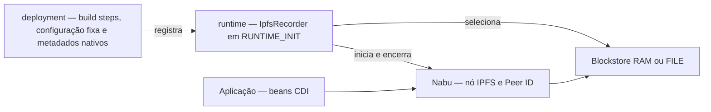

# Quarkus IPFS

[English](README.md) · **Português (Brasil)**

<p>
  <a href="https://github.com/Peergos/nabu/blob/d2454c9af6e05e15d703ef394687857aab2432a9/README.md"></a>
  <a href="https://quarkus.io/">
    <picture>
      <source media="(prefers-color-scheme: dark)" srcset="https://design.jboss.org/quarkus/logo/final/PNG/quarkus_logo_horizontal_rgb_1280px_reverse.png">
      
    </picture>
  </a>
  <a href="https://github.com/ipfs-inactive/logo/blob/26a8332e2b1dc7e711561bc03f2e39e0c99e76f6/index.md"></a>
</p>

[Logo do Nabu](https://github.com/Peergos/nabu/blob/d2454c9af6e05e15d703ef394687857aab2432a9/README.md) · [Logo do Quarkus](https://github.com/quarkusio/quarkus#readme) · [Logo do IPFS](https://github.com/ipfs-inactive/logo/blob/26a8332e2b1dc7e711561bc03f2e39e0c99e76f6/index.md) ([CC BY-SA 3.0](https://creativecommons.org/licenses/by-sa/3.0/))

Quarkus IPFS incorpora um nó Peergos Nabu em uma aplicação Quarkus. Injete serviços via CDI para armazenar e recuperar blocos por CID, gerenciar conexões com outros nós e trabalhar com DAGs e IPNS. A extensão é experimental.

## Arquitetura do nó embutido

O diagrama mostra como o nó Nabu embutido é configurado no build e inicializado pelo Quarkus. [Plano original de implementação](docs/designs/quarkus-ipfs.md#arquitetura-e-contratos)



## Início rápido

Use Java 21 ou superior e uma aplicação Maven com o BOM do Quarkus 4.0.0. Escolha uma versão publicada. [Quarkus IPFS no Maven Central](https://central.sonatype.com/artifact/io.github.pedropietro/quarkus-ipfs)

Adicione esta dependência à seção `<dependencies>` do `pom.xml` da aplicação.

```xml
<dependency>
    <groupId>io.github.pedropietro</groupId>
    <artifactId>quarkus-ipfs</artifactId>
    <version>0.11.0</version>
</dependency>
```

O exemplo usa `io.quarkus:quarkus-rest`. Adicione essa dependência se a aplicação ainda não usa Quarkus REST. O POM da extensão declara o JitPack para as dependências do libp2p. Se a política do seu projeto ignorar os repositórios declarados por dependências, adicione este repositório à seção `<repositories>` do POM da aplicação. Crie a seção se necessário.

```xml
<repository>
    <id>jitpack.io</id>
    <url>https://jitpack.io</url>
</repository>
```

Crie `src/main/java/org/acme/BlocksResource.java`.

```java
package org.acme;

import java.util.concurrent.CompletionStage;

import jakarta.inject.Inject;
import jakarta.ws.rs.Consumes;
import jakarta.ws.rs.GET;
import jakarta.ws.rs.POST;
import jakarta.ws.rs.Path;
import jakarta.ws.rs.PathParam;
import jakarta.ws.rs.Produces;
import jakarta.ws.rs.core.MediaType;

import io.ipfs.cid.Cid;
import io.quarkiverse.ipfs.runtime.BlockService;

@Path("/blocks")
public class BlocksResource {

    @Inject
    BlockService blocks;

    @POST
    @Consumes(MediaType.APPLICATION_OCTET_STREAM)
    @Produces(MediaType.TEXT_PLAIN)
    public CompletionStage<String> put(byte[] bytes) {
        return blocks.put(bytes, Cid.Codec.Raw).thenApply(Cid::toString);
    }

    @GET
    @Path("/{cid}")
    @Produces(MediaType.APPLICATION_OCTET_STREAM)
    public CompletionStage<byte[]> get(@PathParam("cid") String cid) {
        return blocks.get(cid);
    }
}
```

No diretório da aplicação, execute `mvn quarkus:dev`. Envie um bloco e recupere-o pelo CID.

```sh
cid=$(curl -fsS -H 'Content-Type: application/octet-stream' \
  --data-binary 'hello ipfs' http://localhost:8080/blocks)
curl -fsS "http://localhost:8080/blocks/$cid"
```

A resposta é `hello ipfs`. O armazenamento padrão `RAM` dura enquanto a aplicação estiver em execução. Para persistir blocos, configure `quarkus.ipfs.storage-type=FILE` e indique em `quarkus.ipfs.storage-path` um diretório dedicado em que a aplicação tenha permissão de escrita. [Configuração de armazenamento, Dev Services e rede](docs/modules/ROOT/pages/index.adoc)

## Instalação a partir do código-fonte

Use o Maven Wrapper para instalar uma compilação local.

```sh
git clone https://github.com/pedropietro/quarkus-ipfs.git
cd quarkus-ipfs
./mvnw -B -pl deployment -am install -DskipTests
```

No Windows, substitua `./mvnw` por `.\mvnw.cmd`. O build baixa e verifica o arquivo de fontes da revisão fixada do Nabu.

## Validação da extensão

O Maven Wrapper usa o Maven 3.10.2. A suíte JVM inclui testes com o JAR empacotado.

```sh
./mvnw -B clean verify
```

Em um ambiente Linux com Docker, use Mandrel 25 para compilar e testar o executável nativo para Linux.

```sh
bash ./mvnw -B -pl deployment,integration-tests -am clean verify \
  -Dnative -Dquarkus.native.container-build=true -Dnative.surefire.skip=true \
  -Dquarkus.native.builder-image=quay.io/quarkus/ubi10-quarkus-mandrel-builder-image:jdk-25
```

O GitHub Actions publica os relatórios Surefire e Failsafe dos jobs JVM e nativo. [Workflow de build](.github/workflows/build.yml)

### Teste de streaming UnixFS com heap limitado

O workflow de build importa e lê um arquivo UnixFS de 512 MiB com heap de 64 MiB e confere o tamanho e o SHA-256 do resultado. A aplicação de testes empacotada usa armazenamento de blocos `FILE` no perfil de produção.

```sh
bash integration-tests/src/test/scripts/unixfs-stream.sh jvm integration-tests/target/quarkus-app
bash integration-tests/src/test/scripts/unixfs-stream.sh native integration-tests/target/*-runner
```

### Teste de interoperabilidade com Kubo

O workflow de build executa os cenários UnixFS, IPNS e HTTP autenticado com o JAR e o executável nativo. Cada cenário usa a imagem do Kubo v0.43.1 fixada por digest, em uma rede interna do Docker própria. O workflow publica um log por cenário e inclui os logs dos contêineres em caso de falha.

Para rodar a mesma suíte localmente, execute o comando do modo que você compilou.

```sh
bash integration-tests/src/test/scripts/kubo-ci.sh jvm integration-tests/target/quarkus-app target/kubo-jvm-logs
bash integration-tests/src/test/scripts/kubo-ci.sh native integration-tests/target/*-runner target/kubo-native-logs
```

### Leitura de arquivo UnixFS em streaming pelo Kubo

Com o bean CDI opcional `KuboClient` habilitado, use `writeFile(cid, output)` para ler um arquivo UnixFS em streaming. A aplicação gerencia o `OutputStream` e aguarda o futuro antes de fechá-lo. O futuro retorna o número de bytes gravados. Prazo excedido, cancelamento ou erro de E/S podem deixar uma saída parcial. O cliente libera a resposta HTTP ao atingir o prazo ou ao cancelar a operação. Uma escrita em curso em um destino que ignora interrupções pode terminar após a falha do futuro.

```java
try (var output = Files.newOutputStream(destination)) {
    long bytesWritten = kubo.writeFile(cid, output).join();
}
```

Para usar os RPCs autenticados do Kubo, dê ao token bearer acesso a `/api/v0/cat` para arquivos e a `/api/v0/block/get` para blocos brutos.

### Importação de arquivo UnixFS pelo Kubo

Chame `KuboClient.addFile(input, pin)` para enviar um arquivo em streaming e obter seu CID raiz. Use `pin` para escolher se o Kubo deve conservar o arquivo durante a coleta de lixo. Feche o fluxo de entrada na aplicação. Dê ao token bearer acesso a `/api/v0/add` para uploads. As duas operações de arquivo sinalizam erro se o Kubo enviar o trailer HTTP `X-Stream-Error`.

```java
try (var input = Files.newInputStream(source)) {
    String cid = kubo.addFile(input, true).join();
}
```

### Teste do cliente HTTP do Kubo

Execute o script após compilar a aplicação em JVM ou nativo. Ele inicia a aplicação empacotada e um servidor Kubo v0.43.1 com autenticação bearer em uma rede isolada do Docker. O teste verifica a leitura de um bloco bruto e compara o tamanho e o SHA-256 de um arquivo UnixFS de 96 MiB lido com heap de 64 MiB. Com o mesmo limite, também importa um arquivo vazio e outro de 96 MiB, verifica o pinning e lê cada CID retornado usando o cliente e o CLI do Kubo.

```sh
bash integration-tests/src/test/scripts/kubo-http.sh jvm integration-tests/target/quarkus-app
bash integration-tests/src/test/scripts/kubo-http.sh native integration-tests/target/*-runner
```

### Teste de IPNS com Kubo

Execute o script com o JAR empacotado ou com o executável nativo para Linux. Ele inicia a aplicação e dois nós Kubo v0.43.1 em uma rede isolada do Docker. O teste verifica publicação e resolução nos dois sentidos, incluindo um registro somente V2 publicado pelo Kubo.

```sh
bash integration-tests/src/test/scripts/kubo-ipns.sh jvm integration-tests/target/quarkus-app
bash integration-tests/src/test/scripts/kubo-ipns.sh native integration-tests/target/quarkus-ipfs-integration-tests-0.11.0-runner
```

### Teste de UnixFS com Kubo

Compile o JAR de testes de integração com o comando JVM acima e inicie uma nova instância da aplicação.

```sh
java -jar integration-tests/target/quarkus-app/quarkus-run.jar
```

Configure o limite das requisições HTTP da aplicação para pelo menos 64 MiB para o cenário com arquivos UnixFS de vários blocos. Em outro terminal, inicie o Kubo em modo offline e execute a troca de blocos a partir da raiz do repositório.

```sh
docker run --rm -d --network none --name quarkus-ipfs-kubo --entrypoint sh ipfs/kubo:v0.43.1 -ec '
  ipfs init --profile=test
  exec ipfs daemon --offline
'
# Aguarde "Daemon is ready" no log do contêiner antes de iniciar o teste.
QUARKUS_URL=http://127.0.0.1:8080 KUBO_CONTAINER=quarkus-ipfs-kubo \
  bash integration-tests/src/test/scripts/kubo-unixfs.sh
docker stop quarkus-ipfs-kubo
```

O teste transfere blocos por CID e verifica se as duas implementações leem o arquivo original de vários blocos e sua entrada de diretório.

[Preparação da publicação no Maven Central](docs/publishing-central.md)
