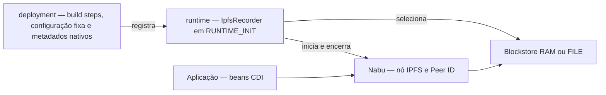

# Plano de implementação da extensão Quarkus IPFS

**Status** · Proposta · 2026-11-22  
**Destino** · [pedropietro/quarkus-ipfs](https://github.com/pedropietro/quarkus-ipfs)

## Visão geral

A extensão permite que uma aplicação Quarkus armazene e recupere conteúdo IPFS por CID usando beans CDI. A proposta parte da implementação local com um nó Java Nabu no processo da aplicação. A primeira entrega experimental estabiliza o armazenamento de blocos, o ciclo de vida do nó, o modo dev e o empacotamento. A versão proposta é `0.1.0`, sujeita à confirmação do histórico de tags no GitHub.

## Problema e ponto de partida

- A cópia local já contém os módulos Maven `runtime`, `deployment`, `integration-tests` e `docs`, com Quarkus `3.37.2`, compilação para Java 17 e Nabu `0.8.0` via JitPack. O artefato de consumo é `io.quarkiverse.ipfs:quarkus-ipfs`.
- `IpfsRecorder` cria sempre um `RamBlockstore`, embora o contrato anuncie `FILE`. As chaves `run-bitswap` e `metrics-enabled` ainda aparecem na configuração sem governar as operações que descrevem.
- Em hot reload, o ramo que diz reutilizar o Dev Service retorna sem o build item do nó. O processador principal então segue pelo caminho de criação de um novo nó. O teste de hot reload contém apenas uma asserção de template. No JAR local do Nabu, `EmbeddedIpfs.start()` registra um hook na JVM, e `stop()` não remove esse hook. O mesmo método ativa descoberta mDNS.
- Os relatórios locais existentes registram 12 testes JVM bem-sucedidos, incluindo a asserção de template. A elaboração deste plano usou esses relatórios como evidência histórica. A cópia de trabalho não tem metadados Git acessíveis e a consulta autenticada ao destino retornou 404. Branch padrão, tags e permissões permanecem por confirmar.

## Versões-alvo

Versões verificadas em 22 de novembro de 2026. A adoção depende da execução da suíte da extensão em JVM e nativo.

| Tecnologia | Base local | Alvo proposto |
| --- | --- | --- |
| Quarkus | `3.40.1.2` no PR 0. | `4.0.0` para alinhar o Nabu ao Netty `4.2.20.Final` e ao Vert.x `5.2.3` gerenciados pelo BOM oficial. [BOM do Quarkus 4.0.0](https://central.sonatype.com/artifact/io.quarkus/quarkus-bom/4.0.0) |
| Java | CI e alvo de compilação em 17 no PR 0. | Java 21 como mínimo para compilar e executar o Nabu atual. A CI verifica Java 21 e Temurin 25.0.5.1+2, com Mandrel 25 no build nativo. [Roadmap do Java](https://www.oracle.com/java/technologies/java-se-support-roadmap.html) · [Release do Temurin](https://github.com/adoptium/temurin25-binaries/releases/tag/jdk-25.0.5.1+2) |
| Maven e compilador | Maven local `3.9.11` e Compiler Plugin `3.15.0` | Maven estável `3.10.2` e Compiler Plugin estável `3.16.0`. Fixar Maven com o Wrapper. [Downloads do Maven](https://maven.apache.org/download.cgi) · [Releases do Compiler Plugin](https://github.com/apache/maven-compiler-plugin/releases) |
| Quarkiverse Parent | `22` | `22`, versão mais recente encontrada. [Releases do Quarkiverse Parent](https://github.com/quarkiverse/quarkiverse-parent/releases) |
| Nabu | `0.8.0` via JitPack no PR 0. | Compilar o commit oficial `d2454c9af6e05e15d703ef394687857aab2432a9` no módulo `nabu-upstream`, com SHA-256 do arquivo de origem e licença MIT no JAR. O commit adota libp2p `0.21.19` e Netty `4.2.19.Final`. [Nabu no commit fixado](https://github.com/Peergos/nabu/tree/d2454c9af6e05e15d703ef394687857aab2432a9) |
| Build nativo | Builder padrão da versão atual do Quarkus | Mandrel 25, com a imagem oficial atualizada do Quarkus para JDK 25. Registrar o digest efetivamente usado pela CI. [Suporte do Quarkus ao Mandrel 25](https://quarkus.io/blog/mandrel-25-minimum-version/) · [Estado das imagens oficiais](https://quarkus.io/blog/java4shell/#patched-images) |
| GitHub Actions | `checkout@v6` e `setup-java@v5` | `checkout@v7.0.1` e `setup-java@v6.3.0` no runner hospedado. [Checkout](https://github.com/actions/checkout/releases/tag/v7.0.1) · [Setup Java](https://github.com/actions/setup-java/releases/tag/v6.3.0) |

As tags `v0.8.1` e `v0.9.1-quic` falharam no JitPack. O commit adotado aceita `async-bootstrap` e ainda registra um hook global em `start(boolean)`. O teste de hot reload deve verificar a liberação de todos os recursos a cada ciclo. [Código do Nabu no commit fixado](https://github.com/Peergos/nabu/blob/d2454c9af6e05e15d703ef394687857aab2432a9/src/main/java/org/peergos/EmbeddedIpfs.java)

O libp2p usa o codec QUIC gerenciado pelo Quarkus, compartilhado com o Vert.x. A implementação do fork do Netty foi excluída para evitar classes duplicadas. A configuração padrão do swarm usa TCP. Endereços QUIC exigem o classificador de `netty-codec-native-quic` da plataforma de destino. [Guia de dependências QUIC do Quarkus](https://quarkus.io/guides/http3-reference#native-quic-library)

## Objetivos da primeira entrega

1. Injetar `IpfsClient` e `BlockService` e validar o ciclo gravar → obter CID → ler e comparar bytes → remover. Preservar as assinaturas públicas existentes.
2. Manter RAM como padrão. Com `storage-type=FILE`, recuperar o mesmo CID e os mesmos bytes depois de reiniciar com o mesmo diretório. Com chave configurada, preservar também o Peer ID.
3. Iniciar exatamente um nó por execução da aplicação habilitada, liberar a porta e os recursos no encerramento e repetir esse ciclo com hot reload. Respeitar as flags da extensão e dos Dev Services.
4. Verificar a extensão em JVM e executar a aplicação empacotada em modo nativo antes de anunciar suporte nativo. Expor readiness quando SmallRye Health estiver instalado e a checagem estiver habilitada.
5. Integrar o código e a documentação na branch padrão do repositório de destino, com CI verde e instruções de consumo reproduzíveis.

O suporte a blocos por CID e a conexão direta entre pares formam o contrato inicial. UnixFS para arquivos e diretórios, IPNS com DHT, métricas Micrometer e um cliente HTTP para Kubo ficam em etapas posteriores. Os serviços CDI já existentes de DAG, IPNS e Swarm conservam suas assinaturas. A documentação indica o nível de cobertura de cada operação.

## Jornadas e critérios de aceite

| Cenário | Ação | Resultado esperado |
| --- | --- | --- |
| Desenvolvimento local | Adicionar o artefato, iniciar `quarkus:dev`, injetar `BlockService` e gravar um bloco | O nó sobe em loopback, sem Docker, e o CID permite ler os mesmos bytes |
| Hot reload | Alterar uma classe da aplicação duas vezes com porta dev fixa | Cada recarga volta a atender na mesma porta com um único nó. A RAM começa vazia e o encerramento final libera a porta |
| Persistência | Gravar com `FILE`, encerrar e subir com o mesmo diretório | O CID continua legível com bytes idênticos. A identidade permanece quando configurada |
| Troca IPFS | Conectar dois nós locais e buscar no segundo um bloco gravado no primeiro | A leitura retorna os mesmos bytes via Bitswap. A suíte usa pares conhecidos, com tempo de espera limitado e sem depender da DHT pública |
| Extensão opcional | Subir sem SmallRye Health, com readiness desativado e com a extensão desativada | A aplicação funciona sem Health. O check aparece somente quando habilitado e disponível. Com `quarkus.ipfs.enabled=false`, o CDI consegue montar uma aplicação sem consumidores de IPFS e nenhuma porta IPFS é aberta |

## Arquitetura e contratos



O módulo `deployment` registra o feature, os beans e a integração opcional de Health. O recorder recebe a configuração de execução e inicia rede, armazenamento e identidade em `RUNTIME_INIT`. O bean sintético do nó e o de identidade representam a mesma instância. A integração com Quarkus usa `ShutdownContext` para liberar recursos. [Guia de extensões do Quarkus](https://quarkus.io/guides/writing-extensions/)

**Configuração.** Manter `@ConfigMapping` em `quarkus.ipfs`. A habilitação da extensão, o backend e o readiness continuam fixos no build. Multiaddresses, bootstrap, caminho e chave continuam configuráveis na execução. No modo dev/test, a porta automática vale quando o Dev Service está habilitado e `swarm-addresses` não foi explicitado. Uma configuração explícita prevalece. O padrão usa loopback, porta aleatória, bootstrap vazio e anúncios de blocos desativados. A descrição de descoberta mDNS deve acompanhar o comportamento validado.

**Ciclo de vida.** A proposta é recriar o nó embutido em cada recarga, incluindo a liberação da porta anterior. Manter `devservices.shared` reconhecida durante a transição, depreciá-la e documentar a recriação inclusive para valores antigos `true`. Respeitar `quarkus.devservices.enabled` e `quarkus.ipfs.devservices.enabled` na escolha dos padrões dev/test. Ao desativá-los, o nó regular continua disponível se a extensão estiver habilitada. O suporte a reload depende de um ponto de entrada do Nabu com ciclo de vida gerenciado pelo Quarkus. Se a API da versão atual for insuficiente, a primeira etapa requer uma versão upstream ou uma correção pequena upstream para iniciar sem hook global. [Guia de Dev Services](https://quarkus.io/guides/extension-writing-dev-service/)

**Dados e execução.** `FILE` persiste blocos, incluindo os usados por DAGs, sob um diretório dedicado e gravável. Chave privada e registros DHT têm ciclos próprios. A chave vem da configuração de runtime por uma fonte de segredos e seu valor fica fora de logs e respostas de health. As APIs atuais retornam `CompletableFuture`, mas `getBlocks` e algumas operações de disco podem bloquear antes da conclusão. A correção usa o executor gerenciado pelo Quarkus, com I/O fora do event loop, leitura local antes da busca remota e falhas distintas para CID inválido, bloco ausente e falha de rede ou disco. Definir e testar o limite da busca remota conforme a capacidade real de cancelamento do Nabu. [Nabu](https://github.com/Peergos/nabu)

## Alternativas consideradas

| Opção | Consequência |
| --- | --- |
| Nabu embutido, proposto para a primeira entrega | Reutiliza a API CDI atual e permite desenvolvimento sem daemon separado. O ciclo de vida e a compatibilidade nativa das dependências precisam de validação. |
| Cliente para Kubo via HTTP RPC | Permite uma integração com um nó externo e expõe as operações da API Kubo. Exige provisionamento, transporte autenticado conforme o ambiente e um contrato CDI de cliente. É uma evolução possível para aplicações que já operam Kubo. |
| Serviço externo gerenciado por Dev Services | Permite usar a gestão de reuso e reinício do Quarkus e isola o nó da recarga da aplicação. Implica um processo externo e um protocolo de acesso para substituir o objeto embutido. |

[API RPC do Kubo](https://docs.ipfs.tech/reference/kubo/rpc/) · [Dev Services e reuso](https://quarkus.io/guides/extension-writing-dev-service/)

## Plano de implementação

Antes do primeiro PR, registrar os resultados de uma execução limpa de `mvn -B clean verify` na configuração atual e os desvios entre o ambiente local e a CI. Conferir a resolução do Nabu e de suas dependências em um cache Maven vazio.

### PR 0 · Atualização da base tecnológica

- Em `pom.xml`, atualizar a versão que governa o BOM e os plugins do Quarkus e atualizar o Compiler Plugin. Adicionar os scripts `mvnw`, `mvnw.cmd` e `.mvn/wrapper/maven-wrapper.properties` para fixar o Maven.
- Em `.github/workflows/build.yml` e `.github/workflows/quarkus-snapshot.yaml`, alinhar a CI ao JDK 25 e atualizar as Actions locais conforme a matriz. Executar o build e confirmar a compatibilidade de um consumidor em Java 17 antes de registrar esse mínimo no README.
- A migração posterior usa o módulo `nabu-upstream` para empacotar o commit oficial fixado. Repetir as verificações com o novo mínimo Java 21 e a versão compartilhada do Netty.

**Aceite** · Os módulos compilam e os testes existentes passam com o BOM e as ferramentas propostos. A CI registra as versões usadas e confirma o mínimo de Java anunciado.

### PR 1 · Ciclo de vida e CDI

O módulo nabu-upstream aplica lifecycle.xml às fontes verificadas do commit fixado. O patch permite iniciar sem o hook global no Quarkus, interrompe os workers do Nabu no encerramento e aguarda o fechamento do host e do mDNS. A entrada padrão do Nabu continua instalando o hook para o uso autônomo.

- Em `runtime/src/main/java/io/quarkiverse/ipfs/runtime/IpfsRecorder.java`, receber a configuração de runtime no recorder, criar o nó uma vez, fechar recursos em falhas parciais e registrar parada idempotente com espera limitada. Se o Nabu exigir uma correção upstream para iniciar sem hook global, atualizar a dependência em `pom.xml` neste PR.
- Em `deployment/src/main/java/io/quarkiverse/ipfs/deployment/IpfsProcessor.java`, concentrar a decisão do modo, o registro de CDI e a inicialização. Registrar os beans do nó e os serviços somente com `quarkus.ipfs.enabled=true`. Remover o caminho anterior de `deployment/src/main/java/io/quarkiverse/ipfs/deployment/devservices/IpfsDevServicesProcessor.java` e `IpfsDevServicesBuildItem.java`, junto com `runtime/src/main/java/io/quarkiverse/ipfs/runtime/IpfsDevServicesRecorder.java`, após migrar a seleção de porta e o shutdown.
- Em `runtime/src/main/java/io/quarkiverse/ipfs/runtime/config/IpfsDevServicesConfig.java`, documentar a depreciação de `shared` e a precedência entre as configurações.
- Em `deployment/src/test/java/io/quarkiverse/ipfs/test/`, atualizar `IpfsTest.java` para verificar que a fachada e o bean sintético usam a mesma instância. Criar `IpfsDisabledTest.java` para testar a ausência dos beans IPFS com a extensão desabilitada. Substituir o placeholder em `IpfsDevModeTest.java` por recargas reais e testar flags global e local, precedência de porta e encerramento.

**Aceite** · Uma instância por ciclo, porta liberada após shutdown e recargas sem acumular hooks nem threads do nó.

### PR 2 · Blocos e configuração

A API de blocos entrega falhas pelo CompletableFuture. CID inválido gera IllegalArgumentException, ausência gera NoSuchElementException, falhas de rede geram BlockFetchException e falhas de disco preservam a causa de I/O. A busca remota tem um limite de 30 segundos para a resposta. O Nabu expira requisições pendentes por bloco e limita a descoberta de provedores. Cancelar o future do chamador não garante cancelar todas as operações de rede iniciadas pelo libp2p.

- Em `runtime/src/main/java/io/quarkiverse/ipfs/runtime/IpfsRecorder.java`, selecionar `RamBlockstore` ou `FileBlockstore` conforme a configuração. Com `FILE`, criar o diretório dedicado quando necessário e falhar com diagnóstico se ele for inválido ou inacessível. Exigir que o caminho seja explicitado nesse modo, para o usuário escolher onde os blocos serão gravados.
- Em `runtime/src/main/java/io/quarkiverse/ipfs/runtime/BlockService.java`, usar o executor gerenciado no I/O e estabelecer os contratos de leitura local, busca remota e falhas. Em `runtime/src/main/java/io/quarkiverse/ipfs/runtime/config/`, alinhar `IpfsBuildTimeConfig.java` e `IpfsRuntimeConfig.java` à implementação e documentar o alcance de `async-bootstrap`, `run-bitswap` e `metrics-enabled`.
- Em `integration-tests/src/test/java/io/quarkiverse/ipfs/it/IpfsResourceTest.java`, substituir a dependência de ordem pelo ciclo autocontido de gravação, leitura, comparação e remoção. Retirar chaves inertes de `integration-tests/src/main/resources/application.properties` e de `deployment/src/test/java/io/quarkiverse/ipfs/test/IpfsTest.java`.
- Criar `IpfsBlockstorePersistenceTest.java` e `IpfsPeerExchangeTest.java` em `deployment/src/test/java/io/quarkiverse/ipfs/test/` para verificar reabertura com `FILE` e troca via Bitswap em rede controlada.

**Aceite** · Recuperar por CID em RAM, após reinício com FILE e por um segundo nó. Cobrir CID inválido, bloco ausente, diretório inválido e identidade estável com chave configurada.

### PR 3 · Health e imagem nativa

- Em `deployment/pom.xml`, depender do SPI de Health. Em `deployment/src/main/java/io/quarkiverse/ipfs/deployment/IpfsHealthProcessor.java`, registrar readiness apenas com extensão e check habilitados e com a capacidade SmallRye Health presente. Em `runtime/src/main/java/io/quarkiverse/ipfs/runtime/health/IpfsHealthCheck.java`, responder pela disponibilidade local com diagnósticos controlados.
- Em `deployment/src/main/java/io/quarkiverse/ipfs/deployment/IpfsNativeProcessor.java`, ajustar reflexão, recursos e inicialização com base em falhas reproduzidas. Em `integration-tests/pom.xml` e `integration-tests/src/test/java/io/quarkiverse/ipfs/it/IpfsResourceIT.java`, habilitar os testes empacotados em JVM e nativo e limitar a configuração do caminho do binário ao perfil nativo.
- Criar `integration-tests/src/test/java/io/quarkiverse/ipfs/it/IpfsHealthDisabledTest.java` com um perfil de teste que desabilita o check. Usar `deployment/src/test/java/io/quarkiverse/ipfs/test/IpfsTest.java` sem a dependência Health para cobrir o caso sem SmallRye.
- Em `.github/workflows/build.yml`, separar as verificações de JVM e nativo e salvar os relatórios de ambos. Usar JDK 25 para verificar a JVM e a imagem oficial atualizada de Mandrel 25 para gerar o executável em Linux.

**Aceite** · Executar operações de bloco e readiness no JAR e no binário nativo. Verificar também inicialização sem SmallRye Health.

### PR 4 · Guia e entrega no GitHub

- Em `README.md`, documentar instalação, exemplo CDI, compatibilidade e comandos. Em `docs/modules/ROOT/pages/index.adoc`, documentar RAM, FILE, ciclo dev e rede. Regenerar `docs/modules/ROOT/pages/includes/quarkus-ipfs.adoc` e `quarkus-ipfs_quarkus.ipfs.adoc` desse diretório pelo plugin do módulo `docs`. Em `runtime/src/main/resources/META-INF/quarkus-extension.yaml`, manter o status experimental e apontar para o guia acessível.
- Em `pom.xml`, alinhar o SCM ao destino confirmado. Conferir `.github/project.yml`, `.github/workflows/pre-release.yml`, `.github/workflows/release-prepare.yml` e `.github/workflows/release-perform.yml` antes de alterar a versão ou publicar. Se o fluxo Quarkiverse exigir permissões indisponíveis no repositório pessoal, usar o GitHub como canal de entrega inicial.

**Aceite** · PR integrado à branch padrão do destino, CI verde, exemplo executado em um projeto consumidor com cache Maven vazio e instruções de instalação correspondentes ao canal disponível.

### Verificação de build

Executar os comandos a partir da raiz, com o ambiente de CI documentado.

```sh
bash ./mvnw -B clean verify -DskipITs=false
bash ./mvnw -B -pl deployment,integration-tests -am clean verify -Dnative \
  -Dquarkus.native.container-build=true -Dnative.surefire.skip=true \
  -Dquarkus.native.builder-image=quay.io/quarkus/ubi10-quarkus-mandrel-builder-image:jdk-25
```

O primeiro comando deve rodar os testes de extensão, de hot reload e da aplicação JVM, incluindo o JAR empacotado. O segundo deve executar `IpfsResourceIT` contra o binário nativo em Linux. Conferir os relatórios do Surefire e do Failsafe. O teste de consumidor deve resolver também as transitivas do Nabu a partir de um repositório Maven vazio e verificar a coexistência das dependências de rede e criptografia gerenciadas pelo BOM. [Guia de build nativo](https://quarkus.io/guides/building-native-image/)

## Publicação e evolução

- **Entrega no GitHub.** Confirmar a branch padrão e o acesso ao repositório indicado antes de abrir os PRs e alinhar o SCM. Depois do merge, registrar as notas e a primeira versão experimental confirmada pelas tags. Validar se os workflows reutilizáveis do Quarkiverse e os respectivos direitos de publicação se aplicam ao destino.
- **Distribuição Maven.** Usar `io.quarkiverse.ipfs` no Central somente com autorização para esse namespace. Se a publicação não estiver disponível, a entrega inicial pode usar o código versionado no GitHub e instalação por `mvn install`. Antes de anunciar instalação pelo Central, validar em cache vazio quais dependências ainda exigem JitPack e documentar o repositório necessário. [Namespaces do Maven Central](https://central.sonatype.org/register/namespace/) · [Quarkiverse](https://github.com/quarkiverse/quarkiverse/wiki)
- **UnixFS.** Validar o esquema e a ordenação de links, usar o tipo UnixFS File (2) para arquivos e Directory (1) para diretórios e passar vetores de arquivo vazio, de múltiplos blocos e de diretório. Manter leitura de CIDs gerados pelo formato anterior onde distinguível. Só declarar interoperabilidade depois de trocas com Kubo nos dois sentidos. [Especificação e vetores UnixFS](https://specs.ipfs.tech/unixfs/)
- **IPNS e métricas.** Validar publicação e resolução entre pares controlados, expiração e seleção do registro mais recente. Incorporar métricas em etapa própria, usando a integração opcional do Quarkus. [Guia de métricas para extensões](https://quarkus.io/guides/writing-extensions/#extension-metrics)

<!-- Estrutura de design baseada no Elephant-Goldfish Model. -->
